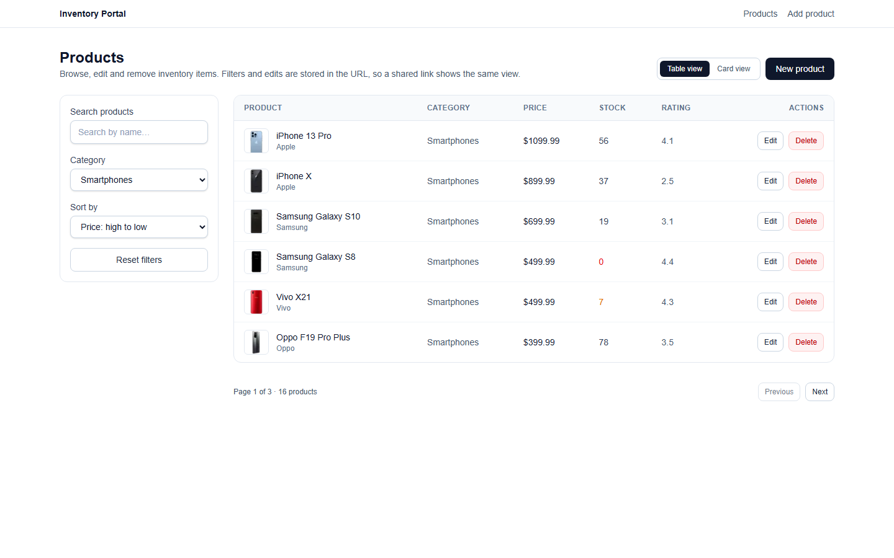
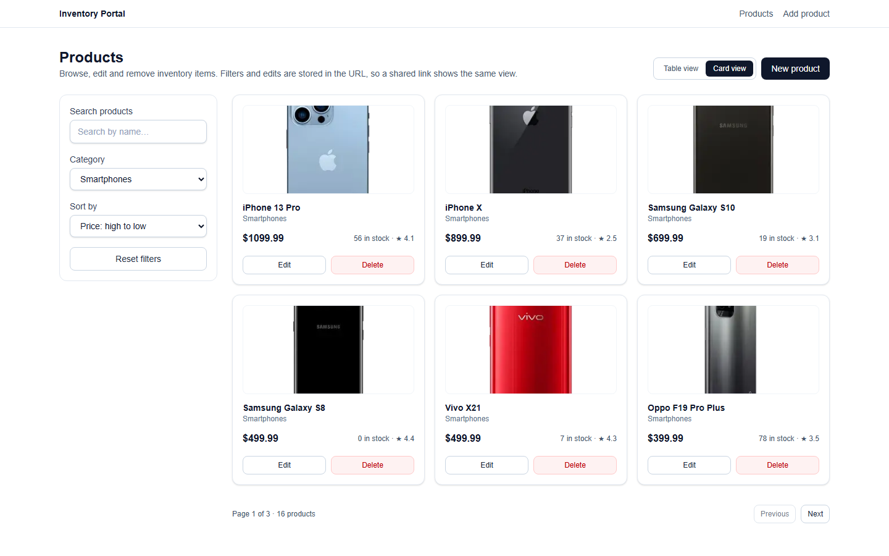
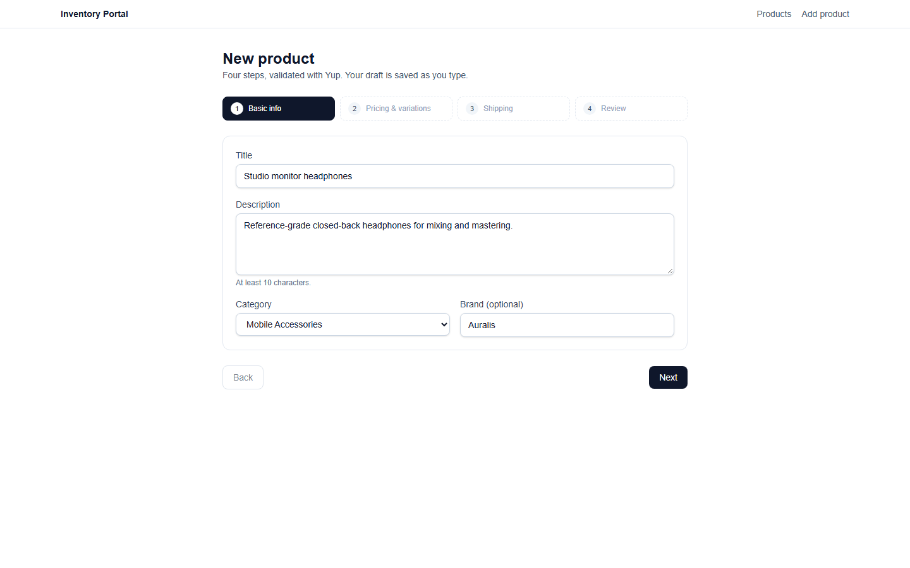

# Product & Inventory Portal

A product and inventory portal built with the **Next.js App Router**, **TypeScript (strict)**,
**Redux Toolkit + RTK Query**, **React Hook Form + Yup** and **pure Tailwind CSS**.

It ships two screens:

| Route | What it does |
| --- | --- |
| `/products` | Product directory: debounced search, category + sort filters, URL-synced state, table/card views, skeletons, empty state, mobile filter drawer, optimistic edit/delete with rollback and a retry toast. |
| `/products/new` | Four-step creation wizard (basic info → pricing & variations → shipping → review) with a category dropdown sourced from the products API, Yup validation, dynamic variations, conditional fragile-item rules, draft persistence and resume prompt. |

## Screenshots

| Directory (table) | Directory (cards) |
| --- | --- |
|  |  |



Captured from the production build against the live DummyJSON API.

## Tech stack

| Concern | Choice |
| --- | --- |
| Framework | Next.js 16 App Router, TypeScript `strict` (+ `noImplicitAny`, `noUnusedLocals`, `noUnusedParameters`) |
| Server/client boundary | `app/layout.tsx` stays a Server Component; Redux lives in a `Providers` client component |
| Server data | RTK Query only — no duplicated product arrays in a slice |
| Client state | Redux Toolkit slices: `filtersSlice`, `uiSlice`, `wizardSlice` |
| Form state | React Hook Form + Yup; keystrokes stay in RHF, only draft snapshots reach Redux/localStorage |
| URL state | `search`, `category`, `sort`, `page`, `limit` and the `writes` overlay mirrored into query params |
| Optimistic updates | RTK Query `onQueryStarted` + `updateQueryData` + per-entity `patch.undo()` |
| Styling | Pure Tailwind utilities, no UI component library |
| Tests | Vitest + React Testing Library + MSW v2 |

## Getting started

```bash
npm install
npm run dev          # http://localhost:3000/products
```

| Script | Description |
| --- | --- |
| `npm run dev` | Next.js dev server (Turbopack) |
| `npm run build` | Production build (type-checks as part of the build) |
| `npm start` | Serve the production build |
| `npm test` | Vitest suite (102 tests: unit + integration) |
| `npm run test:watch` | Vitest in watch mode |
| `npm run lint` | ESLint (`eslint-config-next` + React Compiler rules) |
| `npm run typecheck` | `tsc --noEmit` |

### Environment

```bash
cp .env.example .env.local
```

| Variable | Default | Purpose |
| --- | --- | --- |
| `NEXT_PUBLIC_FAILURE_RATE` | `0.2` | Fraction (0..1) of **write** requests (`POST`/`PUT`/`DELETE`) that fail on purpose, so optimistic rollback + retry can be exercised. `0` disables it. The test suite forces `0`. |

## Architecture

```
src/
  app/
    layout.tsx                  # Server Component shell + header
    providers.tsx               # "use client" Redux Provider (store created once)
    page.tsx                    # redirects to /products
    products/
      page.tsx                  # Server wrapper: awaits searchParams, renders client inside <Suspense>
      ProductsClient.tsx        # hydrates the filters slice, then mounts the directory
      new/page.tsx              # wizard route
  components/
    ui/                         # Button, Field/Input/Select/Textarea/Checkbox, Modal, Toast, Skeleton, Drawer, EmptyState
    products/                   # ProductTable, ProductCardGrid, ProductFilters, ViewToggle, Pagination, EditProductModal, ProductsDirectory
    wizard/                     # WizardShell, Step1..Step4, VariationRow (React.memo)
  store/
    index.ts                    # makeStore() + typed RootState/AppDispatch
    hooks.ts                    # useAppDispatch / useAppSelector
    slices/                     # filtersSlice, uiSlice, wizardSlice
    api/
      baseQuery.ts              # fetchBaseQuery + failure simulation
      productsApi.ts            # queries, mutations, optimistic patches
  schemas/productSchemas.ts     # Yup schemas (per step + whole draft)
  hooks/                        # useDebouncedValue, useProductUrlSync, useRetryPayload
  utils/                        # filters (parse/serialize/canonical), sortProducts, normalizeCategories, draftStorage, productDraft
  test/                         # setup, MSW server + handlers, render helper
```

### Request / state flow on `/products`

1. `app/products/page.tsx` (Server Component) awaits `searchParams` and parses them with
   `parseViewParams` — the URL carries both the filters and the successful writes, so it is the
   source of truth for a shared link.
2. The parsed view is passed to the client component inside a `<Suspense>` boundary
   (required by Cache Components for runtime data).
3. `ProductsClient` seeds the persisted write overlay (from the link, else `localStorage`), then
   dispatches `hydrateFilters({ ...initialFilters, instanceId })` once per mount and renders the
   directory only when the slice's `hydratedFor` matches its own `useId()`. The store outlives the
   component, so a plain `isHydrated` boolean would let a remount render (and request) the filters
   left behind by the previous visit.
4. `useProductUrlSync` then keeps URL ↔ Redux in sync in both directions, comparing **canonical
   signatures** (filters + writes) so the two effects cannot fight each other.
5. `ProductsDirectory` derives the RTK Query argument from the filters slice. The cache is keyed by
   the full argument object and keeps only the subscribed argument, so a superseded request is
   aborted rather than left running.

## Solution: the four architecture questions

Each answer states the guarantee, the mechanism that provides it, the code that implements it, and
the test that proves it.

### 1. Race condition handling in the product search

**Goal.** Rapid typing must never produce one request per keystroke, and a response that belongs to
an older query must never be rendered, or cached in a way that a later view can read it.

Three independent defences, applied in this order:

| # | Defence | Where |
| --- | --- | --- |
| 1 | 300 ms trailing debounce; only the committed term reaches Redux | `useDebouncedValue`, `ProductFilters` |
| 2 | Commit a **trimmed** term, so whitespace cannot create a second cache key or URL state | `ProductFilters`, `buildProductsPath` |
| 3 | Abort the superseded request and evict its cache entry | `productsApi` (`keepUnusedDataFor: 0`) |

**1. Debounce plus a canonical commit value.** The input keeps local state so keystrokes never touch
Redux. The debounced value is trimmed before dispatch, and `lastSyncedSearch` stores the *canonical*
value so the Redux → input direction cannot fight the pending keystrokes:

```tsx
const [searchInput, setSearchInput] = useState(filters.search);
const debouncedSearch = useDebouncedValue(searchInput, SEARCH_DEBOUNCE_MS);
const lastSyncedSearch = useRef(filters.search);

useEffect(() => {
  const term = debouncedSearch.trim();
  if (term === lastSyncedSearch.current) return;
  lastSyncedSearch.current = term;
  dispatch(setSearch(term));           // resets page to 1
}, [debouncedSearch, dispatch]);

useEffect(() => {
  if (filters.search === lastSyncedSearch.current) return;   // back nav / reset
  lastSyncedSearch.current = filters.search;
  setSearchInput(filters.search);
}, [filters.search]);
```

**2. Cancellation, not just cache-key isolation.**

```ts
getProducts: builder.query<ProductsResponse, ProductQueryArgs>({
  query: (args) => buildProductsPath(args),
  // Only the subscribed argument is kept. On argument change RTK Query
  // unsubscribes from the old key, aborts the request still running for it and
  // evicts the entry, so a late response has nowhere to land.
  keepUnusedDataFor: 0,
  transformResponse: (response, _meta, arg) => ({
    ...response,
    products: sortProducts(response.products ?? [], arg.sort ?? 'featured'),
  }),
  providesTags: /* list + per-product tags */,
}),
```

RTK Query already threads an `AbortSignal` into `fetchBaseQuery`, but it only aborts an in-flight
query when the cache entry is **removed**. Setting `keepUnusedDataFor: 0` makes that removal happen
immediately on unsubscribe, which turns "the argument changed" into a real network abort instead of a
wasted request that resolves into a dead cache key. Eviction also matters for correctness: an aborted
fetch would otherwise leave an error entry that a backspace (e.g. `pho` → `phone` → `pho`) could read.

Cache-key isolation remains the second line of defence: entries are keyed by the **entire** argument
object (`search`, `category`, `sort`, `page`, `limit`), and the hook only subscribes to the current
one.

**3. No loading flash.** Because entries are evicted, `data` is `undefined` between arguments. The
component keeps the last page it rendered, so nothing collapses to a skeleton or a one-frame
"No products found" — including the frame before the new request is registered:

```tsx
const [lastResult, setLastResult] = useState<ProductsResponse | null>(null);
if (data && data !== lastResult) setLastResult(data);      // React's documented
                                                            // render-phase state adjustment
const result = data ?? (isError ? null : lastResult);
const showSkeleton = !result && !isError;
const isRefreshing = isFetching && Boolean(result);
```

**Proof.**

- `ProductsRaceConditions.test.tsx > aborts the superseded request and never renders its late
  response` — a delayed MSW handler attaches an `abort` listener to `request.signal`; the test types
  `pho`, waits for the request, types `ne`, then asserts the abort fired and that the delayed payload
  (`STALE PHONE`) never appears while the current result (`iPhone 15`) does.
- `ProductsDirectory.test.tsx > trims the debounced search term before committing it` — typing
  `iPhone ` mirrors `/products?search=iPhone`, never `iPhone+`.
- `ProductsDirectory.test.tsx > keeps the current rows on screen while the next request is in flight`
  — no skeleton and no empty state during the refresh.

**Trade-off.** With `keepUnusedDataFor: 0`, returning to a previously viewed page or search refetches
instead of serving a warm entry. That is the cost of evicting entries that may hold an aborted
response; `categories` and single products keep the default 120 s.

### 2. State distribution boundaries

**Rule applied.** Every piece of state has exactly one owner, and the layer is chosen by *lifetime*
and *who needs to read it*:

| Layer | Owns | Deliberately does not own | Reason |
| --- | --- | --- | --- |
| RTK Query cache (`productsApi`) | `products`, `categories`, single product, request status, optimistic patches | filters, view mode, draft | Server data has an expiry, a cache key and a revalidation policy. Putting it in a slice means hand-writing invalidation. |
| Redux Toolkit (`filtersSlice`, `uiSlice`, `wizardSlice`) | Active filters (+ which mount hydrated them), view mode, toast queue and retry payloads, wizard step and draft snapshot | Product collections, request status | These are read by siblings that are not in a parent/child relationship, and must survive a remount. |
| React Hook Form | Field values, touched/dirty state, validation errors — the wizard **and** the directory's edit modal | Anything that must survive a remount | Field state changes on every keystroke; Redux would mean a dispatch and a selector notification per character. |
| URL (`?search=&category=&sort=&page=&limit=`) | The shareable view | Anything not worth sharing | Handled by `useProductUrlSync` with canonical signature comparison, so the two directions cannot ping-pong. |

**The cache is per-argument, not normalized.** RTK Query stores one entry per query argument, so the
same product legitimately appears in several cached pages. That is not an accident to be tidied away —
it is why `updateProduct`/`deleteProduct` walk `selectCachedArgsForQuery` instead of patching one
array, and why rollback has to be per-entity (§4).

**Crossing a boundary safely.**

- *RHF → Redux (draft):* a debounced `watch` subscription copies a **deep-cloned** snapshot into
  `wizardSlice` and `localStorage`. The clone matters because Immer freezes whatever enters the store
  and RHF's value objects are the same references. The snapshot is skipped when its serialized form
  has not changed, so an autosave burst cannot churn the store.
- *Server → URL:* never. The URL is derived from `filtersSlice`, not from the cache.
- *Server → form:* the edit modal seeds `defaultValues` from the product it was opened with (mounted
  per id, no state-syncing effect), never from a cached array it keeps re-reading.

**Hydration is mount-scoped, not a boolean latch.** The store outlives the component, so
`isHydrated: true` left over from a previous visit would let a remount render — and request — the
previous filters for one commit before the new ones are applied. The slice instead records *which
mount* hydrated it:

```ts
// filtersSlice
hydrateFilters(state, action: PayloadAction<HydrateFiltersPayload>) {
  const { instanceId, ...values } = action.payload;
  const next = { ...DEFAULT_FILTERS, ...values };
  // ...assign fields...
  // Omitted by the URL sync, which must not invalidate the current mount.
  if (instanceId !== undefined) state.hydratedFor = instanceId;
},
```

```tsx
// ProductsClient
const instanceId = useId();                         // unique per mount
const hydratedFor = useAppSelector(selectFiltersHydratedFor);

useEffect(() => {
  dispatch(hydrateFilters({ ...initialFiltersRef.current, instanceId }));
}, [dispatch, instanceId]);

const isReady = hydratedFor === instanceId;
useProductUrlSync(isReady);
if (!isReady) return <ProductsPageSkeleton />;
```

**One validation source.** Both forms use `useForm` with a Yup resolver, and the numeric rules live in
the schemas (`productDraftSchema`, `editProductSchema`) instead of being hand-rolled in `onSubmit`:

```tsx
const { register, handleSubmit, formState: { errors, isSubmitting } } = useForm<EditProductFormValues>({
  resolver: yupResolver(editProductSchema),
  defaultValues: { price: product.price, stock: product.stock },
  mode: 'onTouched',
});
```

**Proof.**

- `ProductsRaceConditions.test.tsx > hydrates before requesting, even when the store already holds
  filters` — poisons the store with a stale term, remounts, and asserts the first request is the
  server-provided term.
- `filtersSlice.test.ts > records which screen instance hydrated the filters` — a URL-driven
  rehydrate keeps the current mount id, so back/forward navigation cannot un-ready the screen.
- `EditProductModal.test.tsx > validates with the shared schema and does not close`.

### 3. Re-render optimization in the dynamic SKU variations array

**The shape of the problem.** `variations` is a `useFieldArray`: rows are added and removed at runtime,
each row has four inputs, and typing in row *n* must not touch rows *n ± 1*. The budget is: **typing
causes zero React renders** (RHF writes to uncontrolled inputs), and **structural or validation
changes touch only the affected row**.

| Technique | What it buys | Where |
| --- | --- | --- |
| Uncontrolled `register(...)` inputs | keystrokes never re-render the step at all | `Step2PricingVariations`, `VariationRow` |
| One step mounted at a time | typing in step 2 cannot render step 1/3/4 | `WizardShell` |
| `key={field.id}` (not the index) | add/remove does not remount unrelated inputs | `Step2PricingVariations` |
| `React.memo` row | a parent render does not cascade into rows | `VariationRow` |
| **Primitive** error props | the memo actually holds when the parent re-renders | `VariationRow` / `Step2` |
| Narrow `selectCurrentStep` selector | autosave does not re-render the shell at all | `WizardShell` |
| `useCallback` handlers | `onRemove`/`append` identities stay stable for the memo | `Step2PricingVariations` |

**The two details that make the memo real.**

1. The row receives flat strings, never an object. An object literal built during render gets a new
   identity every time, so `memo`'s shallow compare would always fail:

```tsx
// Step2PricingVariations
{fields.map((field, index) => (
  <VariationRow
    key={field.id}
    index={index}
    register={register}
    {...readVariationErrors(errors, index)}   // { colorError, sizeError, skuError, extraPriceError }
    onRemove={handleRemove}
  />
))}

// VariationRow
export const VariationRow = memo(function VariationRow({
  index, register, colorError, sizeError, skuError, extraPriceError, onRemove,
}: VariationRowProps) { /* four uncontrolled inputs */ });
```

2. The shell subscribes to a number, not to the slice object. `saveDraft` produces a new slice object
   every 500 ms while typing, so `useAppSelector(selectWizard)` re-rendered the shell → the step → every
   row → and, with object error props, defeated the memo at roughly 2 Hz:

```tsx
// before: re-renders the whole form on every autosave
const { currentStep } = useAppSelector(selectWizard);

// after: a primitive that only changes when the step changes
const currentStep = useAppSelector(selectCurrentStep);
```

**Deliberate non-goals.** A row re-renders when rows before it are removed, because its `index` (and
therefore its `register` path `variations.${index}.color`) changes — that is inherent to RHF's name
scheme, not a missing memo. Virtualising a list that realistically holds a handful of SKU variants
would add complexity without changing the render budget.

**Proof.**

- `VariationRow.test.tsx > skips re-rendering when only unrelated parent state changed` — `register` is
  invoked four times per render, so the test counts the calls: a re-render with identical primitives
  calls it zero times.
- `VariationRow.test.tsx > re-renders when its own error message changes` — the same count flips back
  to four.
- `wizardSlice.test.ts > exposes a currentStep selector whose value survives draft saves` — the slice
  object changes while the selected primitive does not, which is exactly what React-Redux needs to
  skip the render.

### 4. Resilience strategy for optimistic updates

**Lifecycle.** `updateProduct` and `deleteProduct` implement the same four steps: patch every cached
list immediately, remember the patch handles, await the write, then either confirm or undo.

```ts
// updateProduct, abridged (success toast omitted)
async onQueryStarted({ id, data }, { dispatch, getState, queryFulfilled }) {
  const token = Symbol('update');
  latestWriteByProduct.set(id, token);

  const patches = productsApi.util
    .selectCachedArgsForQuery(getState(), 'getProducts')
    .map((args) =>
      dispatch(productsApi.util.updateQueryData('getProducts', args, (draft) => {
        const target = draft.products.find((product) => product.id === id);
        if (target) Object.assign(target, data);   // per-field patches, not an array replace
      })),
    );

  try {
    await queryFulfilled;
    if (latestWriteByProduct.get(id) === token) latestWriteByProduct.delete(id);
  } catch {
    if (latestWriteByProduct.get(id) !== token) {
      // A newer write for this product owns the cache: report it, never undo it.
      dispatch(showToast({ type: 'error', message: 'Update failed, but a newer change for this product was kept.' }));
      return;
    }
    latestWriteByProduct.delete(id);
    patches.forEach((patch) => patch.undo());
    dispatch(showToast({
      type: 'error',
      message: 'Update failed. Previous values restored.',
      retry: { kind: 'update', id, data },
    }));
  }
}
```

**Why the recipe mutates instead of replacing.** `Object.assign(target, data)` makes Immer record
patches against `products[i].price` / `products[i].stock`. The obvious alternative —
`draft.products = draft.products.map(...)` — records a single `replace` of the whole array, so its
inverse patch restores an array snapshot taken before *that* mutation, silently discarding any other
product's concurrent optimistic change. `deleteProduct` uses `splice(index, 1)` plus a `total - 1`
patch for the same reason.

**Why the token guard.** Two writes can overlap for the same product (save, reopen, save again). If the
older one fails after the newer one succeeded, undoing its patches would revert fields the newer write
already confirmed. Each mutation registers a token; a failure only rolls back while it is still the
newest write for that id, and otherwise reports without touching the cache. Concurrent writes to the
same product therefore resolve **last-write-wins** instead of "last failure wins".

**Why the retry path is guarded and queued.**

| Risk | Fix |
| --- | --- |
| A retry payload stored as a closure cannot be serialized | `RetryPayload` is plain data; the toast re-dispatches the endpoint by name |
| Double-click or a replayed action applies the same write twice | `useRetryPayload` keeps an in-flight `Set` keyed by the serialized payload |
| A second failure overwrote the first toast, losing its recovery action | `showToast` appends to a bounded `toastQueue`; `clearToast` promotes the next one |
| The 8 s auto-dismiss timer could swallow the only way to recover a failed write | Toasts **carrying a retry payload never auto-dismiss** |

```ts
// useRetryPayload
const key = JSON.stringify(payload);
if (inFlight.current.has(key)) return;          // already retrying this exact write
inFlight.current.add(key);
void request.unwrap().catch(() => undefined).finally(() => inFlight.current.delete(key));
```

**The UI never lies about the outcome.** `EditProductModal` closes only after `unwrap()` succeeds and
shows the field error inline on failure, so a rejected save is visible in place *and* as a rollback
toast — the previous implementation closed first and left the user to interpret a toast.

**Proof.**

- `optimisticMutations.test.ts > removes a product immediately and restores it when the delete fails`
  — asserts the row and `total` disappear optimistically and both return on rollback.
- `optimisticMutations.test.ts > does not let a late failure revert another product updated meanwhile`
  — product 2's optimistic price survives product 1's later rollback.
- `optimisticMutations.test.ts > keeps the newest change when an older update for the same product
  fails later` — the token guard keeps `42`, not the older `5`.
- `useRetryPayload.test.tsx > sends one request when the same payload is retried twice in a row`.
- `uiSlice.test.ts > queues a second notification instead of discarding the first retry payload`.
- `EditProductModal.test.tsx > stays open when the request fails so the values can be corrected`.

**Known limits** (chosen, not overlooked):

| Limit | Reason |
| --- | --- |
| A retry cannot be server-idempotent | DummyJSON does not persist writes; a real API would need an `Idempotency-Key` |
| Concurrent edits to the *same* product are last-write-wins | Correctness would require per-entity versioning or a serialized mutation queue |
| A background refetch completing mid-mutation is not merged with the optimistic value | Only reachable through the manual retry/refetch path; a merge strategy would need `serializeQueryArgs` + a write log |
| No request timeout is configured | `fetchBaseQuery` supports one; the failure simulation and abort path cover the behaviours under test |

**Verification.** `npm test` (102 tests), `npm run lint` (0 errors), `npm run typecheck` and
`npm run build` all pass.

## API notes and limitations

The app talks to [DummyJSON](https://dummyjson.com/docs/products).

- **`search` + `category` + `sort` cannot be combined.** `/products/search`, `/products/category/{slug}`
  and `/products` are separate endpoints, so `buildProductsPath` applies an explicit priority:
  `search` → `category` → plain collection. When both are present the search wins; the category select
  still shows the chosen category, but the request is the search one.
- Sorting is requested from the server (`sortBy`/`order`) **and** re-applied in `transformResponse`, so
  the order stays correct for any payload the mock API returns.
- DummyJSON's write endpoints are fake: `POST /products/add`, `PUT /products/{id}` and
  `DELETE /products/{id}` return a plausible response but nothing is persisted. Successful edits and
  deletes are therefore recorded in a `localStorage` overlay
  (`inventory-portal:product-writes`, see `productWriteOverlay.ts`) and replayed onto every products
  response, so they survive a refresh and later filter refetches. After reload the original fixtures
  are still used as the base data; the overlay is the session's source of truth.
- **The overlay also travels in the URL** (`?writes={"u":{"1":{"price":123}},"d":[2]}`), added to the
  link whenever the overlay changes. Opening that link in another browser replaces that browser's
  local overlay, so the recipient sees the same edits and deletions. The payload is canonicalised
  (ids and fields sorted) so a URL that describes the same view always produces the same signature.
- Categories are normalized (`normalizeCategories`) because the endpoint has returned both plain slugs
  and `{ slug, name, url }` objects.
- **Cache retention is deliberate.** `getProducts` sets `keepUnusedDataFor: 0`, so exactly one query
  argument is cached at a time and changing filters aborts the superseded request. Revisiting a
  previous page/search therefore refetches instead of re-reading a possibly-poisoned entry;
  `categories` and single products keep the default 120 s.

## Testing

```bash
npm test           # 102 tests
```

| File | Scope |
| --- | --- |
| `src/schemas/productSchemas.test.ts` | SKU regex, duplicate SKUs, price/stock rules, fragile conditional validation |
| `src/store/slices/filtersSlice.test.ts` | search/category/sort/page/limit transitions, hydrate (+ mount id), reset |
| `src/store/slices/uiSlice.test.ts` | toast queue ordering, bound, drain |
| `src/store/slices/wizardSlice.test.ts` | step clamping, draft save/clear, submitted flag, stable `currentStep` selection |
| `src/utils/sortProducts.test.ts` | every sort option, input immutability, server sort mapping |
| `src/utils/filters.test.ts` | URL parsing defaults, canonical signatures, round-trip |
| `src/store/api/productsApi.test.ts` | URL priority, pagination offsets, sort forwarding, search trimming |
| `src/store/api/optimisticMutations.test.ts` | delete/update optimistic patch, rollback on failure, per-entity rollback under concurrent mutations, failed writes are not persisted, retry payload, failure-rate configuration |
| `src/store/api/productWriteOverlay.test.ts` | persisted update merging, delete removal + total adjustment, delete supersedes update, corrupt-storage tolerance |
| `src/utils/viewState.test.ts` | `writes` param round-trip, server record form, malformed payloads, canonical signatures |
| `src/hooks/useRetryPayload.test.tsx` | retry de-duplication while a retry is in flight |
| `src/components/ui/Drawer.test.tsx` | scroll lock/restore, focus moved into the panel and returned to the trigger, Escape closes, Tab stays inside |
| `src/components/products/ProductsDirectory.test.tsx` | SSR filter restore, debounced search + URL mirror, trimmed term, no skeleton flash during refresh, category filter, empty state, view toggle, optimistic delete UI, drawer (unique ids per panel, pending search applied on close), error panel |
| `src/components/products/ProductsRaceConditions.test.tsx` | superseded request is aborted and its late payload never renders; a remount never requests stale filters |
| `src/components/products/ProductsViewState.test.tsx` | a successful edit/delete updates the cache without refetching or losing filters/view mode; page, sort and category changes refetch; edits/deletes survive a refresh and later filter refetches; the URL gets a `writes` param and a shared link renders the same data |
| `src/components/products/EditProductModal.test.tsx` | shared schema validation, closes only on success, stays open on failure |
| `src/components/wizard/WizardShell.test.tsx` | full 4-step submission, API-backed category selection, blocked steps, SKU format/duplicate rules, fragile conditional fields, draft resume/discard, draft-snapshot freeze regression |
| `src/components/wizard/VariationRow.test.tsx` | `React.memo` contract: unrelated parent renders and sibling errors do not re-render the row |

Infrastructure: `src/test/setup.ts` starts MSW with `onUnhandledRequest: 'error'` (unmocked requests
fail the suite) and forces `NEXT_PUBLIC_FAILURE_RATE=0`; `src/test/handlers.ts` mocks every DummyJSON
endpoint used by the app.

## Deployment

The app is a plain Next.js App Router project with no server-only secrets:

```bash
npm run build
npm start
```

On Vercel: import the repository, keep the default build command (`npm run build`) and optionally set
`NEXT_PUBLIC_FAILURE_RATE` per environment (use `0` in previews for deterministic demos).

> The repository is prepared for publishing, but no remote/deployment has been created from this
> workspace — add the GitHub and Vercel links here once they exist.

## Definition of done

| Requirement | Status |
| --- | --- |
| `/products?search=phone&category=smartphones&sort=price_desc&page=2` restores the exact view on refresh | ✅ server-side `searchParams` → `hydrateFilters` |
| A shared link reproduces the same data (edits + deletions), not just the filters | ✅ `writes` overlay encoded in the URL → `ProductsClient` seeds the overlay before the first fetch |
| Search debounced 300 ms | ✅ `useDebouncedValue` + trimmed canonical term |
| Superseded search requests cancelled, late payloads dropped | ✅ `keepUnusedDataFor: 0` + argument-keyed cache |
| Concurrent optimistic writes do not clobber each other | ✅ per-entity patches + latest-write token |
| Category dropdown from API | ✅ `getCategories` + `normalizeCategories` |
| Table/card toggle, skeletons, empty state, mobile drawer | ✅ drawer traps focus, closes on Escape, locks page scroll and restores focus |
| Delete/update optimistic with rollback and retry toast | ✅ `patch.undo()` + serializable retry + toast queue |
| Edit/delete keeps the current page, filters and view mode without refetching; changing a filter refetches | ✅ optimistic cache patches + argument-keyed query |
| Edits/deletes survive a page refresh | ✅ successful writes replayed from the `localStorage` overlay |
| 20% simulated failure configurable by env | ✅ `NEXT_PUBLIC_FAILURE_RATE` |
| Wizard has all 4 views and preserves data when editing | ✅ `shouldUnregister: false` + Edit buttons |
| SKU regex and duplicate validation | ✅ |
| Fragile conditional validation | ✅ |
| Draft resume prompt after refresh | ✅ `localStorage` + modal |
| Tests pass with coverage on schemas/slices/utils | ✅ 102 tests, unit + integration |
| `npm run build` passes with zero `any` | ✅ `strict` + `noImplicitAny` |
| README includes the four architecture answers + screenshots | ✅ |

## Implementation notes

- **Cache Components + Redux.** With `cacheComponents` enabled, Next.js fails the prerender when a
  Client Component reads `Math.random()` — and Redux does exactly that when it initialises
  (`@@redux/INIT…`). The store-backed subtree is therefore streamed inside a `<Suspense>` boundary in
  `app/layout.tsx`, which keeps every route buildable while the header stays in the static shell.
- **One toast instance.** `<Toast />` lives in the root layout instead of per route: it survives
  client-side navigation, so timers are never restarted and a stale copy cannot linger from the
  previously visited route.
- **Draft snapshots are cloned** before entering Redux (`cloneDraft`), because Immer deep-freezes
  store payloads and RHF reuses those object references for its own writes.
- **Responsive table.** Category and rating columns collapse below the `md` breakpoint, cell padding
  tightens, the product title wraps instead of truncating and the row actions stack vertically. The
  grid item that holds it is `min-w-0`: without that, the table's min-content width widened the grid
  track and pushed the whole page sideways. On the narrowest phones the table scrolls inside its own
  card rather than overflowing the page.
- **Mobile type scale.** Below `md` the root font size is 18px (see `app/globals.css`), so every
  rem-based Tailwind size — text, padding, tap targets — grows together. Form controls use
  `text-base` on phones because iOS zooms a focused field whose font is under 16px.
